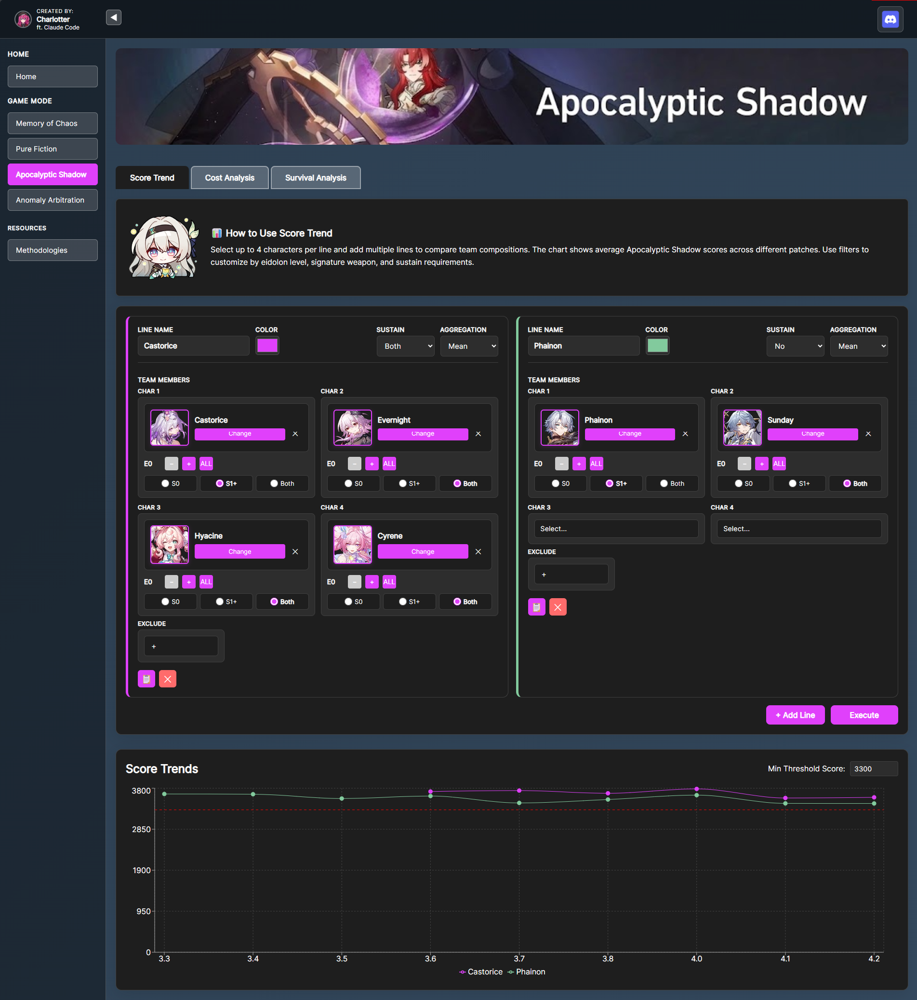

# HSR Endgame Analytics

## Credits
- Player data: [LvlUrArti](https://github.com/LvlUrArti/MocStats)
- Built by [Charlotter](https://discord.com/users/charlotterxd) ft. [Claude Code](https://claude.ai/code)

**THIS IS POSSIBLE BECAUSE OF CLAUDE BECAUSE I'M TOO DUMB AT CODING**

---



A community data tool for Honkai: Star Rail's endgame modes. Explore score trends, compare team investment costs, track character longevity, and dig into aggregate community statistics — all powered by real player clears.

---

## Features

- **Score Trend** — Track average team scores across patches for MOC, PF, AS, and AA
- **Cost Analysis** — See how scores scale with pull investment (E0 to E6, with/without signature LC)
- **Survival Analysis** — Measure how long a character stays relevant after release
- **AA Statistics** — Community-wide passing rates, top DPS teams, cycle distribution, and average cost for Anomaly Arbitration

---

## Prerequisites

- [Docker](https://www.docker.com/) and Docker Compose

That's it.

---

## Setup

### 1. Clone the repo

```bash
git clone <repo-url>
cd hsr2
```

### 2. Configure environment

```bash
cp .env.example .env
```

Edit `.env` and fill in your values. The defaults work fine for local Docker usage — at minimum set a strong `ADMIN_PASSWORD`.

### 3. Obtain data files

The player record CSVs are hosted on Hugging Face. Download them with:

```bash
pip install huggingface_hub
python -c "
from huggingface_hub import snapshot_download
snapshot_download(repo_id='charlotterxd/hsr-intelligence', repo_type='dataset', local_dir='.data')
"
```

Or download manually from [huggingface.co/datasets/charlotterxd/hsr-intelligence](https://huggingface.co/datasets/charlotterxd/hsr-intelligence) and place the files in `.data/`:

```
.data/
  char.csv       # Character metadata
  pf.csv         # Pure Fiction records
  moc.csv        # Memory of Chaos records
  apo.csv        # Apocalyptic Shadow records
  aa.csv         # Anomaly Arbitration records
```

### 4. Start the app

```bash
docker compose up --build
```

This will:
- Start PostgreSQL and run the schema initialisation automatically
- Start the FastAPI backend on `http://localhost:8000`
- Start the React frontend on `http://localhost:5173`

### 5. Load data

Once containers are running, load all player records:

```bash
docker compose exec backend python /database/upsert_all_data.py
```

This uses a fast COPY + temp table approach and handles millions of rows in seconds.

---

## Stack

| Layer    | Technology                  |
|----------|-----------------------------|
| Frontend | React + Vite + Recharts     |
| Backend  | FastAPI (Python)             |
| Database | PostgreSQL 15                |
| Infra    | Docker Compose               |

---

## Project Structure

```
hsr2/
├── frontend/        # React app (Vite)
├── backend/         # FastAPI app
├── database/        # Schema init SQL + data loading scripts
├── .data/           # CSV data files (not committed — obtain separately)
├── .env.example     # Environment variable template
└── docker-compose.yml
```

---

## API Docs

With the backend running, visit `http://localhost:8000/docs` for the interactive Swagger UI.

